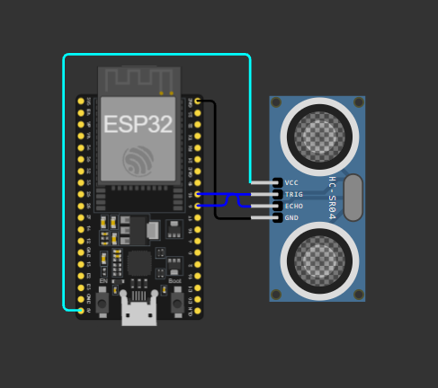

# 💧 HidroBairro Sul — IoT & Inteligência Artificial

Sistema de monitoramento inteligente desenvolvido com **Internet das Coisas (IoT)** e integração com **Inteligência Artificial (IA)**, com o objetivo de coletar dados por sensores, disponibilizá-los por meio de uma API e permitir sua utilização em aplicações inteligentes.

O projeto utiliza um ESP32 conectado a um sensor ultrassônico HC-SR04, responsável pela medição de distância. Os dados são disponibilizados em formato JSON para que a API Java possa consultá-los e utilizá-los no sistema.

---

## 📌 Sobre o projeto

O HidroBairro Sul busca utilizar tecnologias IoT e Inteligência Artificial para auxiliar no monitoramento e na análise de informações coletadas por sensores.

A proposta é conectar dispositivos físicos a uma aplicação capaz de receber, processar e interpretar os dados coletados, possibilitando o desenvolvimento de soluções inteligentes para acompanhamento e tomada de decisão.

Atualmente, a implementação IoT está concentrada na comunicação entre o ESP32 e a API Java.

### Objetivos

- Realizar a coleta de dados utilizando sensores conectados ao ESP32.
- Disponibilizar as informações por meio de uma API HTTP.
- Permitir que a aplicação Java consulte os dados do dispositivo.
- Preparar a estrutura para integração com Inteligência Artificial.
- Possibilitar futuras análises e interpretações dos dados coletados.

---

## 🛠️ Tecnologias utilizadas

| Tecnologia | Aplicação |
|---|---|
| C++ | Programação do ESP32 |
| ESP32 | Microcontrolador principal |
| HC-SR04 | Sensor ultrassônico |
| Wi-Fi | Comunicação de rede |
| HTTP | Comunicação entre aplicações |
| JSON | Formato de troca de informações |
| Wokwi | Simulação do circuito IoT |
| Java | Integração e processamento dos dados |
| Inteligência Artificial | Análise inteligente dos dados (em desenvolvimento) |

---

## 🔌 Hardware e componentes

Atualmente, a implementação utiliza:

- 1 ESP32.
- 1 sensor ultrassônico HC-SR04.
- Conexões por GPIO.



### Ligações do circuito

| HC-SR04 | ESP32 |
|---|---|
| VCC | 5V |
| TRIG | GPIO 5 |
| ECHO | GPIO 18 |
| GND | GND |

### Circuito no Wokwi

O circuito é desenvolvido e testado utilizando o simulador Wokwi.

---

## ⚙️ Funcionamento do sistema IoT

O ESP32 realiza leituras periódicas do sensor ultrassônico e mantém os dados atualizados em sua memória.

Diferentemente de uma arquitetura em que o dispositivo envia automaticamente os dados para outro servidor, neste projeto o ESP32 funciona como um servidor HTTP.

A API Java é responsável por realizar as requisições e consultar as informações disponibilizadas pelo dispositivo.

### Fluxo de comunicação

1. O ESP32 estabelece conexão com a rede Wi-Fi.
2. O sensor HC-SR04 realiza a medição da distância.
3. O ESP32 atualiza os valores coletados.
4. O servidor HTTP disponibiliza os dados em formato JSON.
5. A API Java realiza uma requisição GET para consultar as informações.
6. Os dados podem ser utilizados pelas demais funcionalidades da aplicação e pela futura integração com IA.

---

## 🌐 API IoT — ESP32

O ESP32 possui um servidor HTTP que disponibiliza os dados coletados pelo sensor.

### Endpoints disponíveis

| Método | Endpoint | Descrição |
|---|---|---|
| GET | `/` | Verifica se o servidor IoT está ativo. |
| GET | `/status` | Retorna os dados atuais do sensor em JSON. |

### Exemplo de requisição

```http
GET /status
```

### Exemplo de resposta JSON

```json
{
  "distanciaCm": 45.50,
  "data": "2026-11-10",
  "horario": "19:22:00",
  "leituraValida": true
}
```

**Descrição dos campos:**

| Campo | Descrição |
|---|---|
| `distanciaCm` | Distância medida pelo sensor, em centímetros. |
| `data` | Data da leitura. |
| `horario` | Horário da leitura. |
| `leituraValida` | Indica se a medição foi realizada corretamente. |

As leituras são atualizadas em intervalos de aproximadamente 2 segundos.

---

## 🤖 Integração com Inteligência Artificial

A Inteligência Artificial faz parte da proposta do HidroBairro Sul, permitindo que os dados coletados pelos dispositivos IoT sejam utilizados para análises mais avançadas.

A arquitetura prevê que as informações disponibilizadas pelo ESP32 sejam consultadas pela API Java e posteriormente utilizadas pela camada de Inteligência Artificial.

### Fluxo previsto

```text
Sensor HC-SR04
      |
      v
     ESP32
      |
      v
  API IoT (HTTP)
      |
      v
    API Java
      |
      v
Inteligência Artificial
      |
      v
 Análise e interpretação
      |
      v
 Aplicação / Dashboard
```

### Possibilidades de utilização da IA

- Análise dos dados coletados pelos sensores.
- Identificação de comportamentos fora do padrão.
- Interpretação das informações do monitoramento.
- Geração de recomendações com base nos dados disponíveis.
- Apoio à tomada de decisão.

**Status:** a integração da camada de Inteligência Artificial ainda está em desenvolvimento.

---

## 🚀 Como executar o projeto

### 1. Pré-requisitos

- Visual Studio Code.
- Extensão Wokwi para VS Code.
- Arduino IDE ou ambiente Arduino CLI.
- Extensão ou suporte para desenvolvimento com ESP32.

### 2. Abrir o projeto

Clone o repositório:

```bash
git clone URL_DO_REPOSITORIO
```

Entre na pasta do projeto:

```bash
cd HidroBairro
```

### 3. Configurar o Wi-Fi

No código do ESP32, configure as credenciais:

```cpp
const char* WIFI_SSID = "Wokwi-GUEST";
const char* WIFI_PASSWORD = "";
```

Essas são as configurações utilizadas na simulação do Wokwi.

### 4. Executar a simulação

Abra o projeto no VS Code e inicie o simulador Wokwi.

O ESP32 realizará a conexão Wi-Fi e começará a coletar as informações do sensor.

### 5. Consultar os dados

Com a simulação ativa, o servidor HTTP disponibiliza os endpoints para consulta.

Durante os testes locais, a porta do ESP32 pode ser encaminhada para o computador por meio do arquivo `wokwi.toml`.

Exemplo de configuração:

```toml
[wokwi]
version = 1

[[net.forward]]
from = "localhost:8180"
to = "target:80"
```

Com o encaminhamento configurado, acesse:

```text
http://localhost:8180/status
```

O navegador deverá apresentar os dados em formato JSON.

> **Importante:** esse encaminhamento permite testes locais. Para que uma API Java hospedada externamente consiga acessar o ESP32 simulado, será necessário configurar uma forma de comunicação acessível externamente, como um gateway ou túnel de rede.

---

## 📁 Estrutura do projeto

```text
HidroBairro/
│
└── sketch/
    ├── build/
    ├── sketch.ino
    ├── diagram.json
    ├── libraries.txt
    ├── wokwi-project.txt
    └── wokwi.toml
```

| Arquivo | Responsabilidade |
|---|---|
| `sketch.ino` | Código principal do ESP32. |
| `diagram.json` | Configuração dos componentes e conexões do circuito. |
| `libraries.txt` | Bibliotecas utilizadas no projeto. |
| `wokwi.toml` | Configuração do simulador Wokwi. |

## 👨‍💻 Desenvolvimento

Projeto desenvolvido como parte da iniciativa **HidroBairro Sul**, utilizando tecnologias de IoT e Inteligência Artificial.

**Área de desenvolvimento:** Internet das Coisas (IoT).

**Responsabilidades desta implementação:**
- Desenvolvimento do firmware do ESP32.
- Configuração e integração do sensor HC-SR04.
- Implementação do servidor HTTP.
- Disponibilização dos dados por meio de respostas JSON.
- Preparação da comunicação com a API Java.

---

# 👨‍💻 Equipe

Projeto desenvolvido por:

-   José Diogo - ZeDio 🔗 https://github.com/ZeDio

-   Arthur Dos Santos - Arth.pv 🔗 https://github.com/ArthurCPV

-   Mariana Xavier - Marixavq 🔗 https://github.com/Marixavq

-   Júlia Tiziotto - JúliaB 🔗 https://github.com/JuliaTButtler

-   Bruno Martins - Taikawaititi 🔗 https://github.com/Taikawaititi

---


## 📄 Licença

Projeto acadêmico desenvolvido para fins educacionais e de experimentação tecnológica.